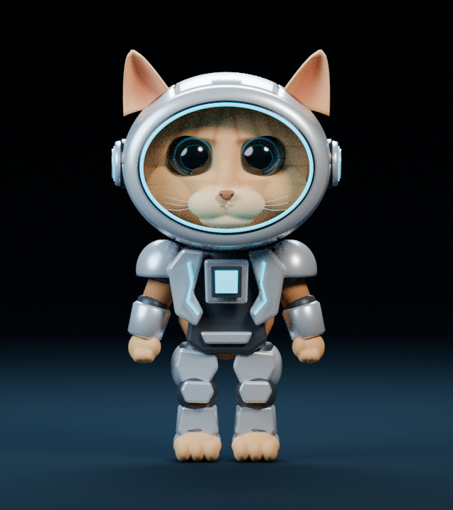
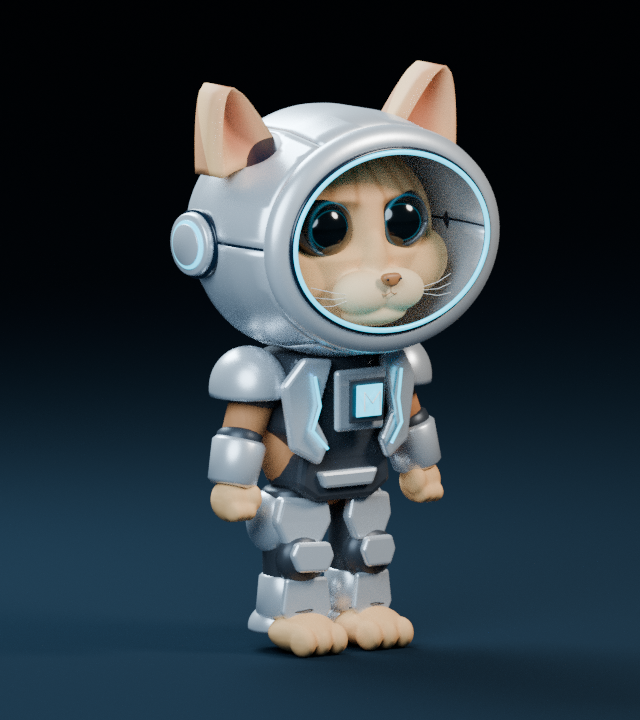
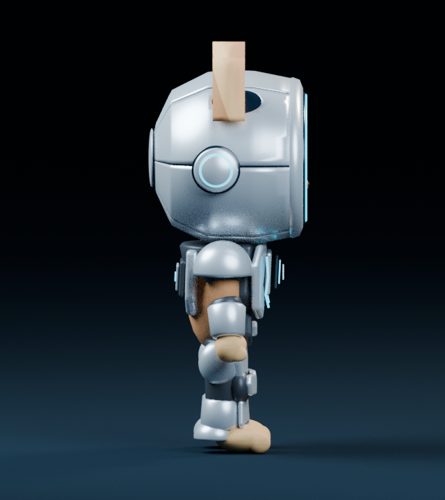
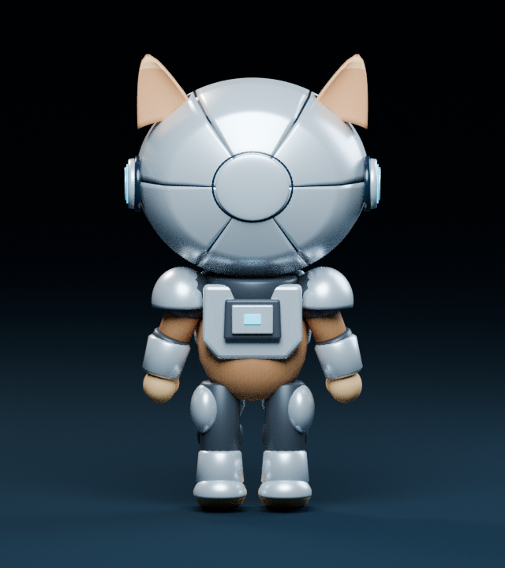

# Minimorph v1 — UNAPPROVED visual rework candidate

The current procedural rework **does not achieve the required facial likeness**.
It remains a work in progress for human review, not a final character.
See [remaining mismatches](../../../docs/character-visual-rework.md).
No rig or animations are implemented.

Measured export: 96,206 triangles, 62,759 vertices, eight materials,
six embedded images, 9,588,016 bytes. These are review assets, not a mobile
performance certification.

- [Exported GLB](minimorph_v1.glb) — self-contained, Y-up, facing negative Z, feet at zero, height 1.8.
- [Editable Blender source](minimorph_v1.blend) — named construction parts, materials and studio setup.
- [Measured validation report](validation.json) — actual triangle/vertex/material counts and bounds.
- [Independent Blender import audit](validation-blender.json).
- [Two-run geometry repeatability](reproducibility.json).
- [Pipeline and reference comparison](../../../docs/character-model-v1.md).

| Front                       | Three-quarter                               | Side                      | Back                      |
| --------------------------- | ------------------------------------------- | ------------------------- | ------------------------- |
|  |  |  |  |

The renders show the actual optimized GLB re-imported into Blender, not a denser
source model. The game keeps its current procedural fallback; this PR provides
the model and a real PlayCanvas inspection/loading test without changing gameplay.

Higher-resolution source renders: [front](renders/source/front.png),
[three-quarter](renders/source/three-quarter.png), [side](renders/source/side.png),
[back](renders/source/back.png). Rejected baseline renders are in `review/`.
Run `npm run preview:character` and open `/comparison.html` for comparison;
original-reference pixels must be selected locally because the supplied blob
URLs are browser-local. A completed comparison with original pixels is pending.
