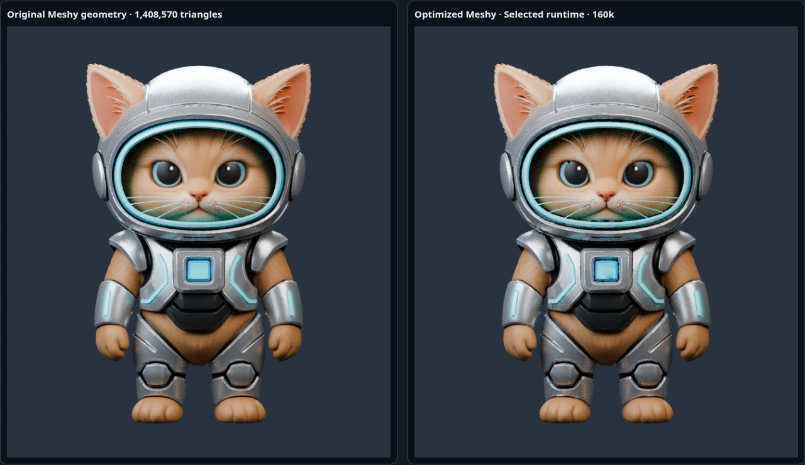
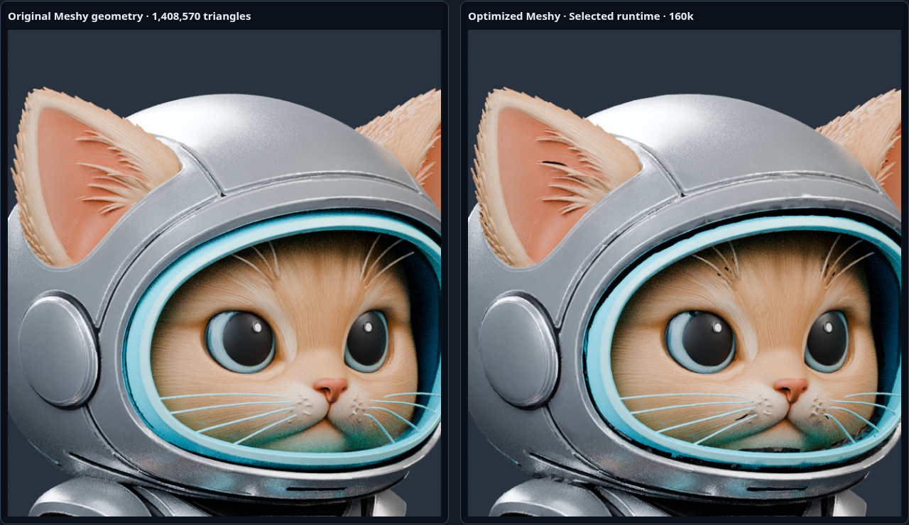

# Official Meshy character — human visual approval pending

The character is derived exclusively from the official [assets-v1 Release](https://github.com/themightydanik/minimorph/releases/tag/assets-v1). No procedural reconstruction or redesign is used. The previous procedural assets/generator have been removed. The 50 MB master and original maps remain in the Release, outside Git and production bundles.

**Selected candidate: 160k**, with source UV-seam protection, preserved high-resolution normals and source normal-detail reprojection. 40k/80k show more pupil/iris distortion; see the comparisons before approving. The higher budget prioritizes the face; it is not a physical-mobile performance certification. No rig or animations are implemented. Production gameplay still uses its existing fallback.

| Candidate | Triangles | Exported vertices | GLB bytes |
| --- | ---: | ---: | ---: |
| 40k | 40,000 | 36,873 | 18,377,348 |
| 80k | 80,000 | 63,305 | 19,976,120 |
| 160k | 160,000 | 145,409 | 25,551,344 |

All candidates have one mesh/primitive/material and three embedded 2048² PNG maps. Original: 1,408,570 triangles, 762,042 exported vertices, 50,384,156 bytes. Runtime height is 1.8, Y-up, facing negative Z with feet at zero. Raw GPU texture storage is approximately 48 MiB without mipmaps, about 64 MiB with mip chains.

- [Selected runtime GLB](minimorph_v1.glb).
- [Source hashes/sizes/URLs](source-manifest.json) and [original inspection](source-inspection.json).
- [Optimization parameters and topology](optimization.json).
- [Local validation results](review/validation-results.json) and PlayCanvas screenshots: [desktop](review/playcanvas-desktop.png), [mobile](review/playcanvas-mobile.png).
- [Actual runtime audit](validation.json), [Blender import](validation-blender.json) and [repeatability experiment](reproducibility.json).
- [Pipeline and reproduction commands](../../../docs/character-model-v1.md).
- [Visual findings, limitations and manual review](../../../docs/character-visual-rework.md).

## Actual optimized GLB renders

| Front | Three-quarter | Side | Back |
| --- | --- | --- | --- |
|  |  |  |  |

## Original Meshy versus selected export

Left is the actual unreduced Meshy geometry with supplied PBR maps; right is the exported/re-imported GLB. Cameras, lighting and exposure match.

All six views are available for [40k](comparisons/40k-front.png), [80k](comparisons/80k-front.png) and selected 160k in `comparisons/`; source renders in `renders/source/`, alternative renders in `renders/candidates/`. Run `npm run preview:character` and open `/comparison.html` to switch views/candidates. No master model or alternate GLBs are needed at runtime.

Remaining issues include small atlas-border/highlight differences at close range, inherited source texture/geometry artifacts, sampling noise and unmeasured physical-mobile performance. No automatic visual approval or merge.
