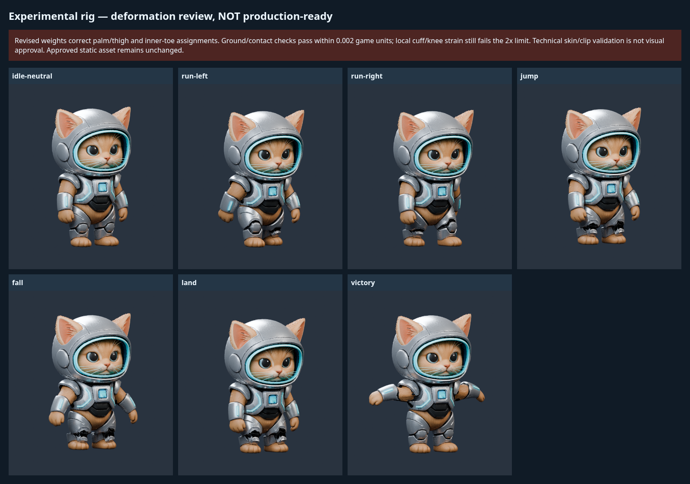

# Revised rig — improved intermediate, strain gate still FAILED

Incorrect palm/thigh and inner-toe/pelvis masks are corrected. Five measured gates pass at 60 Hz, including foot contacts and selected rigid armor cores. **Local cuff/knee strain still exceeds 2x; production readiness and human approval remain false.** The approved static GLB is unchanged.

- [Actual animated GLB](minimorph_animated_v1.glb): 20 bones, six clips, original 160k triangles and three maps.
- [Editable Blender workbench](source/minimorph_rig_workbench.blend): packed textures, rig/actions, studio and named manual-selection sets.
- [Exact minimal manual workflow and reproduction](../../../../docs/character-animation.md).
- [Old/new measurements](rework/comparison.json), [full-frame data](rework/full-frame.json), [topology/PBR diagnosis](rework/semantic-regions.json), [worst regions and gates](quality-status.json).
- [Structural validation](validation.json), [clip metadata](animation-metadata.json), [key-pose diagnostics](deformation.json).

[Rejected baseline sheet](rework/baseline-contact-sheet.png) is preserved from commit `a83af6f`; its functional GLB remains available in Git history. The new maximum stretch is approximately 9.31x versus the baseline 277.94x, still above the unchanged 2x acceptance threshold. No geometry cuts were performed blindly; true cuff/waist connections require focused manual work.

Run `npm run preview:character`, then open `/animation.html` or `/animation-poses.html`. Actual PlayCanvas captures: [desktop](playcanvas-desktop.png), [mobile](playcanvas-mobile.png). Technical loading/playback tests do not approve deformation quality. No production gameplay enablement or merge.

Actual moving-pose captures: [Run desktop](playcanvas-run-desktop.png), [Victory desktop](playcanvas-victory-desktop.png), [Run mobile](playcanvas-run-mobile.png), [Victory mobile](playcanvas-victory-mobile.png).
