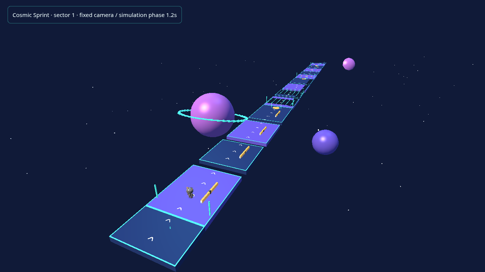
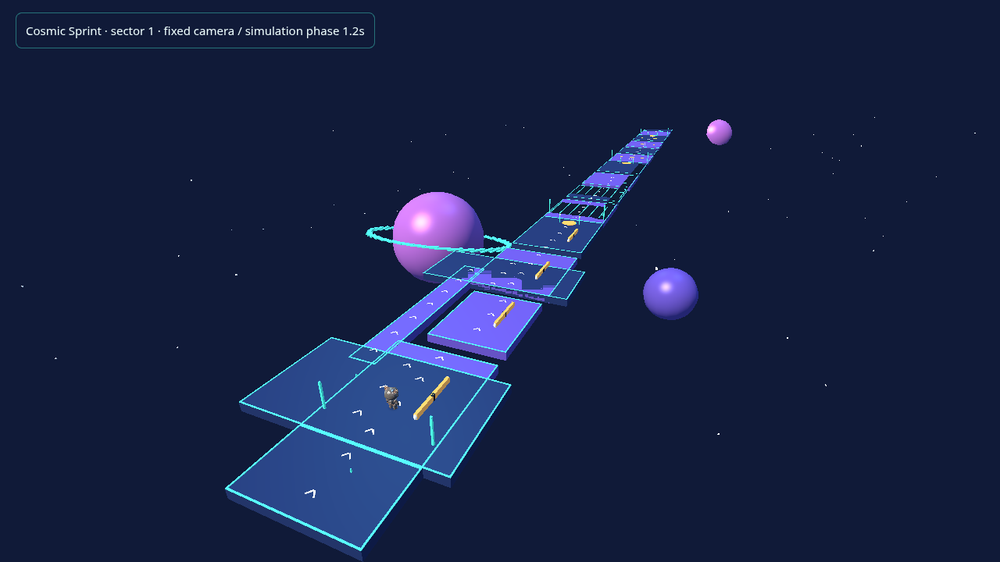
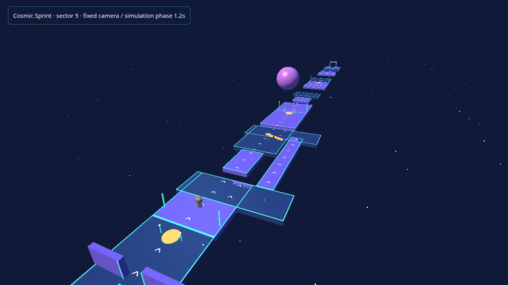
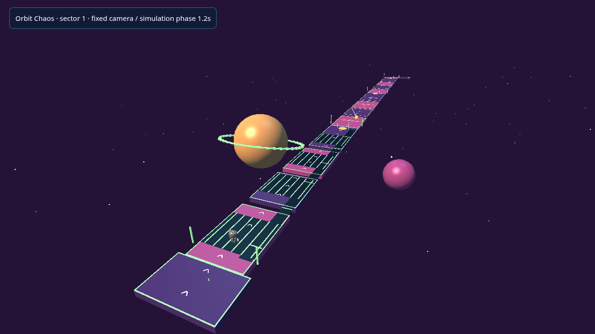
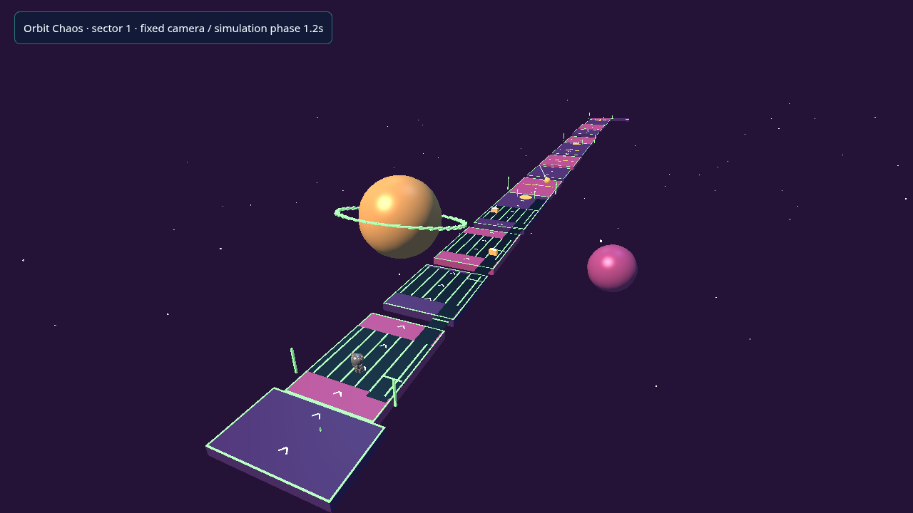
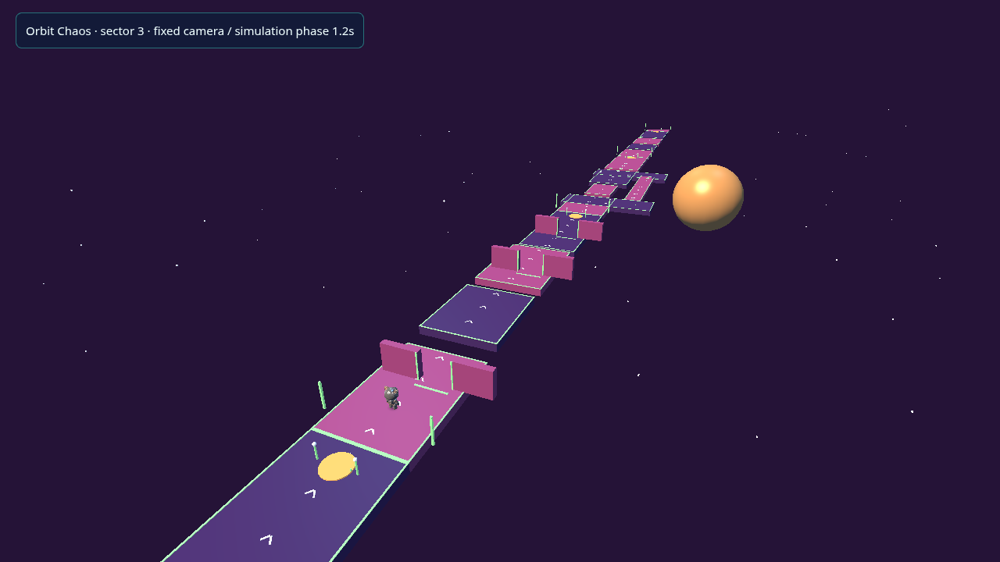
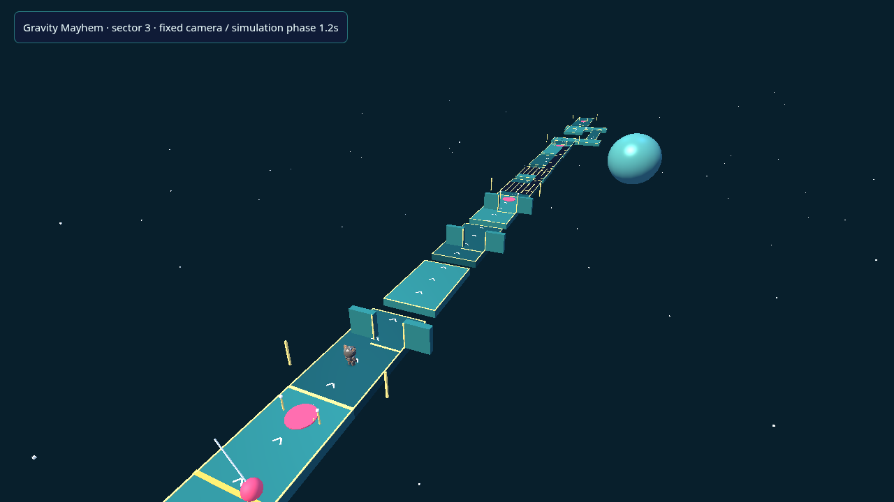
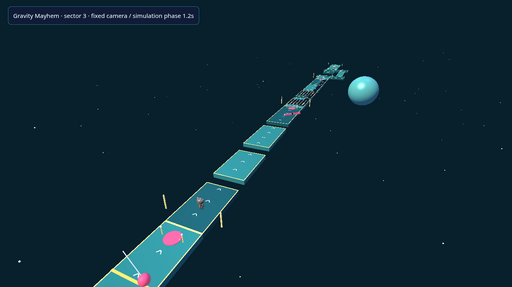
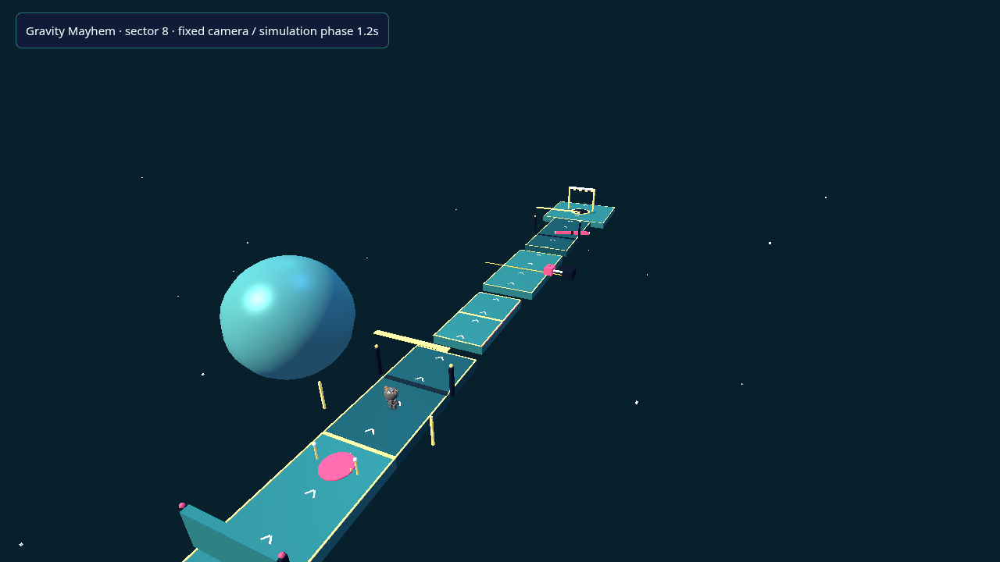
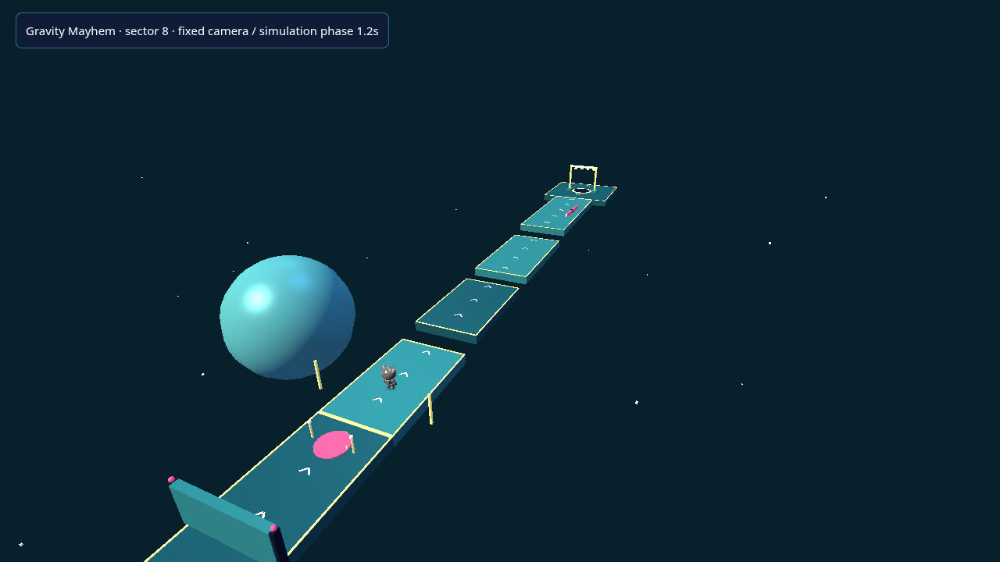

# PR #11 — actual arena comparisons

Baseline: merged PR #10 (`615b14a`). Every image is an actual PlayCanvas render using the approved optimized character and PR #10 lighting/materials. The camera, viewport (1280×720), DPR (1), obstacle phase (1.2 s) and settling interval (1.8 s) match. No compositing or generated illustrations are used. These are staged section inspections, not claims that the character raced to the displayed positions.

| Section | Before | After |
| --- | --- | --- |
| Cosmic Sprint — launch rotor/shuttle and safe bypass |  |  |
| Cosmic Sprint — central shuttle / outer bridge junction |  |  |
| Orbit Chaos — alternating conveyor crossing |  |  |
| Orbit Chaos — raised sliding-window crossing |  |  |
| Gravity Mayhem — new skyward terrace/lift section |  |  |
| Gravity Mayhem — summit approach and raised finish |  |  |

The existing shuttle/outer-bridge geometry is intentionally retained; it now has explicit branch navigation and is used by bot route choices. The new launch bypass, raised crossings, moving supports and skyward finale are physical geometry. All arena palettes, character assets, lighting, VFX, music and settings remain from PR #10.

Limitations: fixed shots show one phase, not the whole motion cycle; physical motion and traversal are checked by deterministic tests and full browser replays. No physical-device frame rate is asserted. The provisional Dive/Slide/Recovery bridge and its external animation requirements remain as documented in PR #10. These images require owner review and do not imply visual approval.

To reproduce after: `npm run preview:character`, then `PLAYWRIGHT_CHROMIUM_EXECUTABLE_PATH=/path/to/chromium node tools/level-review/capture.mjs after`. To reproduce before: create an isolated worktree at merged PR #10, install its dependencies independently (or explicitly alias all workspace packages to that worktree), copy only `level-review.html/.ts` into its character-preview tools, serve on port 5185, and run `node tools/level-review/capture.mjs before 5185` from the review checkout. Do not resolve the baseline's workspace packages to the new implementation. Camera/phase metadata accompanies each capture set.

[Design, navigation, fairness and validation details](../../advanced-levels.md).
