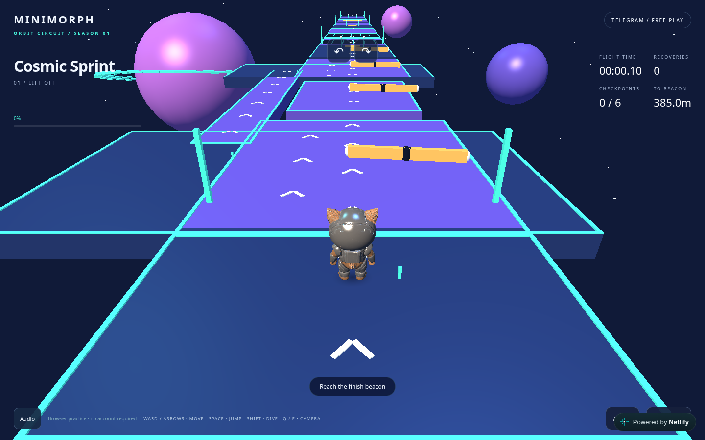
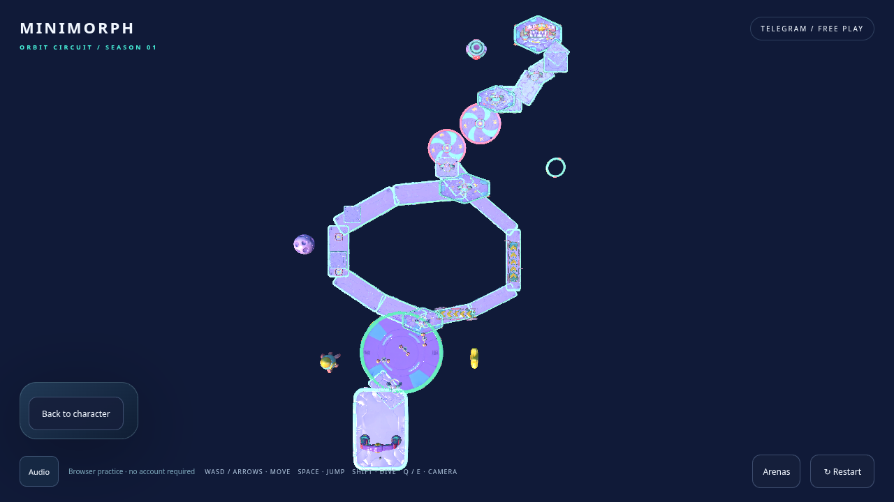

# Cosmic Sprint → Galactic Fun Park

[Open the existing PR preview](https://deploy-preview-13--minimorphnew.netlify.app): choose **Play Cosmic Sprint → Course overview**, or start the Solo race. Matching frontend/backend world revisions are required for multiplayer.

These are captures of the integrated PlayCanvas game, not concept images. `before-main.png` is the published main game before this redesign; desktop zone images come from the local production build, while Turbo Lane and the mobile zones come from successful full CI browser runs ([desktop provenance](ci-desktop.json), [mobile provenance](ci-mobile.json)). Eight-player captures and native-clock measurements are local production-build samples. Every imported CI PNG is unmodified and its hash is recorded. Controlled-clock route recordings use ordinary keyboard/touch inputs, never injected player positions, checkpoints or results. Their frame-time counters are **not performance benchmarks**.

| Review | Before | Redesigned |
| --- | --- | --- |
| Layout |  |  [Mobile overview](mobile-overview.png) |
| Star Launch | | [Desktop](desktop-star-launch.png), [mobile](mobile-star-launch.png) |
| Hammer Plaza | | [Desktop](desktop-hammer-plaza.png), [mobile](mobile-hammer-plaza.png) |
| Turbo Lane | | [Desktop](desktop-turbo-lane.png), [mobile](mobile-turbo-lane.png) |
| Bounce Garden | | [Desktop](desktop-bounce-garden.png), [mobile](mobile-bounce-garden.png) |
| Orbit Carousel | | [Desktop](desktop-orbit-carousel.png), [mobile](mobile-orbit-carousel.png) |
| Star Finish | | [Desktop](desktop-star-finish.png), [mobile](mobile-star-finish.png) |
| Completed legal route | | [Desktop](desktop-bounce-finish.png), [mobile](mobile-bounce-finish.png) |
| Eight approved characters | | [Desktop](desktop-eight-players.png), [mobile](mobile-eight-players.png) |

The deployed preview also passed a native-clock read-only smoke: [published overview](preview-overview.png), [load/error metadata](preview-smoke.json), all 14 environment assets ready and zero page/shader errors.

The former footprint was 23 × 394 m with seven repeated longitudinal sections. The new footprint is approximately 139 × 261 m: a broad launch fan, 48 m plaza, branches separated by 100 m, two rotating discs and a turning final promenade. [Scope integrity](scope-integrity.json) records computed bounds, identical Orbit/Gravity content hashes and protected character/audio/lighting/physics paths.

The short Turbo route completes in 60.44 s and the longer Bounce route in 68.36 s in deterministic recorded runs, both with six checkpoints, zero falls and zero hits. Human races can take longer or encounter hazards. The render captures retain supplied materials, 2048px texture resolution and the approved character; no automatic quality tiers or resolution changes are introduced.

## Performance interpretation

`performance-desktop.json` and `performance-mobile.json` are separate **native-clock** Chromium software-renderer samples: 60 requestAnimationFrame intervals after loading/warmup, eight animated approved characters and real WebSocket snapshots in the actual multiplayer race scene after ordinary owner Start and a bounded review-clock advance through countdown. The existing local review harness then holds server physics between commands. These measure a reproducible rendering workload, not latency, a moving eight-player match or a hardware guarantee. Texture bytes are PlayCanvas tracked texture allocation, not total physical GPU memory.

Measured with Chromium 154.0.8037.57, ANGLE Vulkan **SwiftShader**; all values below are software-browser observations, not mobile hardware estimates. Each row contains 60 native RAF intervals.

| Profile | Render buffer | Players | Environment triangles | Draw calls | Texture MiB | Median / P95 frame ms | Median RAF cadence |
| --- | --- | ---: | ---: | ---: | ---: | ---: | ---: |
| desktop | 1280 × 720 | 8 | 709,060 | 41 | 272.08 | 1283.3 / 2483.3 | 0.779 fps |
| mobile | 618 × 1258 | 8 | 566,036 | 37 | 240.08 | 1233.4 / 2549.9 | 0.811 fps |

Software rendering is slow in both profiles. This sample does **not** establish playable performance on the target device. The different instance/texture counts follow ordinary camera-frustum visibility; the same full-resolution models and existing DPR policy are used in both profiles. The resource timing records include 159,626,430 desktop / 136,259,882 mobile encoded bytes of GLBs and transcoder WASM transferred before this warm sample; they exclude JavaScript/audio and are not a cold-network loading benchmark.

No physical Xiaomi Redmi Note 8 was available. Its approximately 30 FPS target remains subject to real-device validation. Browser mobile emulation is not a substitute for that measurement.

Reproduce functional screenshots with `COSMIC_EVIDENCE=1 PLAYWRIGHT_CHROMIUM_EXECUTABLE_PATH=/usr/bin/chromium npm run test:browser`. Build with `VITE_MULTIPLAYER_WS_URL=ws://127.0.0.1:3001/ws npm run build`, then run `node tools/cosmic-assets/profile.mjs` with the production preview on 5173 and the existing `npm run preview:tournament` review harness on 3013/3012 for native-clock samples. [Asset inventory and reproduction](../../cosmic-sprint-assets.md) contains every source/runtime hash, mesh budget and preparation constraint.

## Verification

[Source CI run](https://github.com/themightydanik/minimorph/actions/runs/42200103434), commit `3c7097e`: core and packages passed (174 tests); desktop **30 passed / 2 expected mobile-only skips**; mobile **32 passed**; required aggregate `validate` passed. Local full Bounce Garden and missing/late-asset cases also passed. The subsequent same-arena retry regression adds one case per profile and passes locally on both desktop and mobile, including a healthy GLB deliberately delayed across retry; final-head outcomes are recorded in the PR. Browser-job headroom is 60 minutes for the expanded GLB suite; all jobs, assertions and required gates remain enabled. The inherited nonblocking strict rig-deformation diagnostic still reports the previously accepted character-art defects; character bytes are unchanged.
