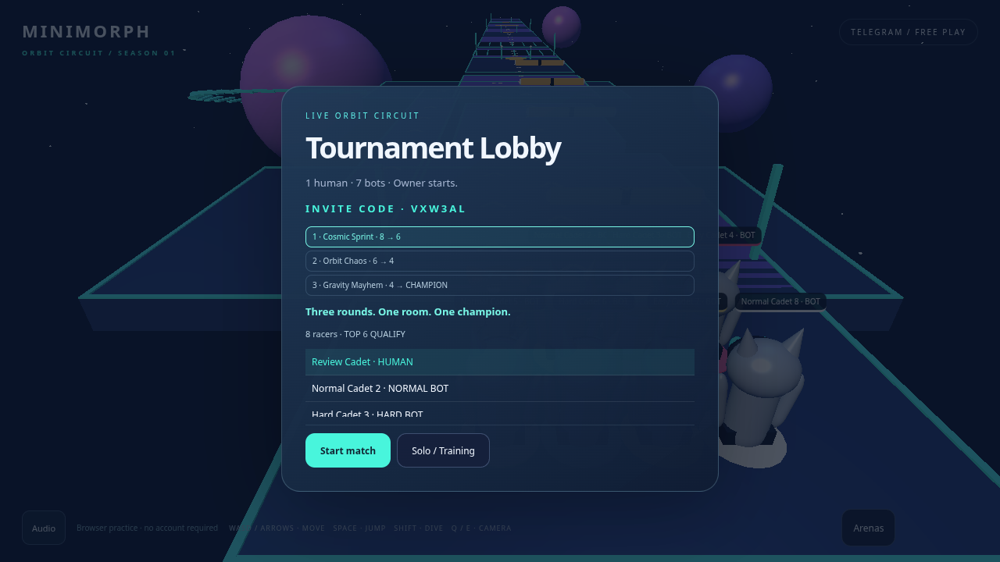
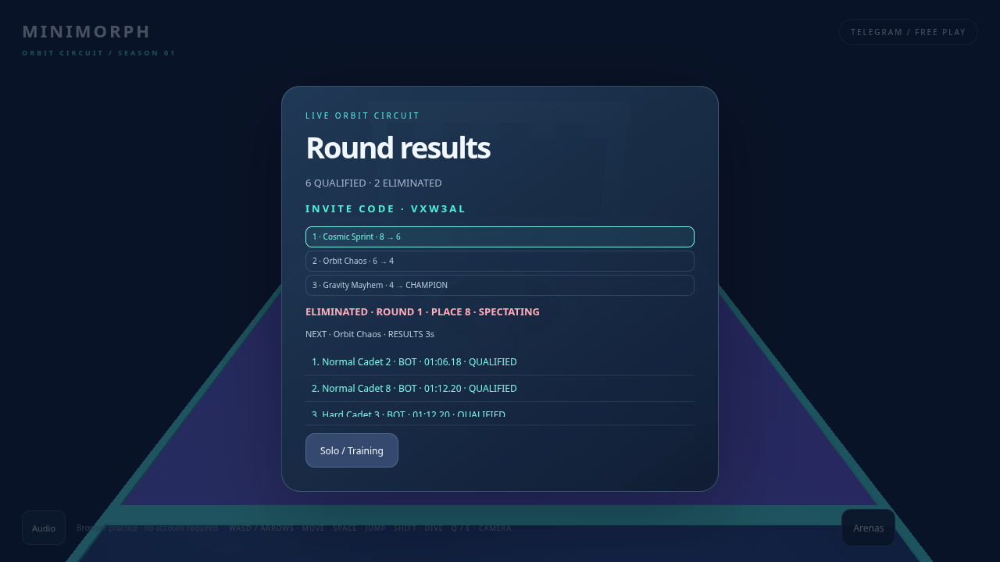
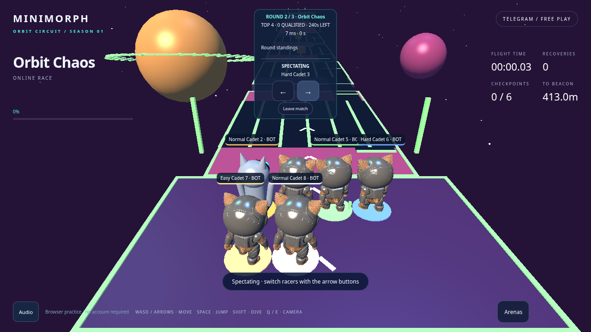
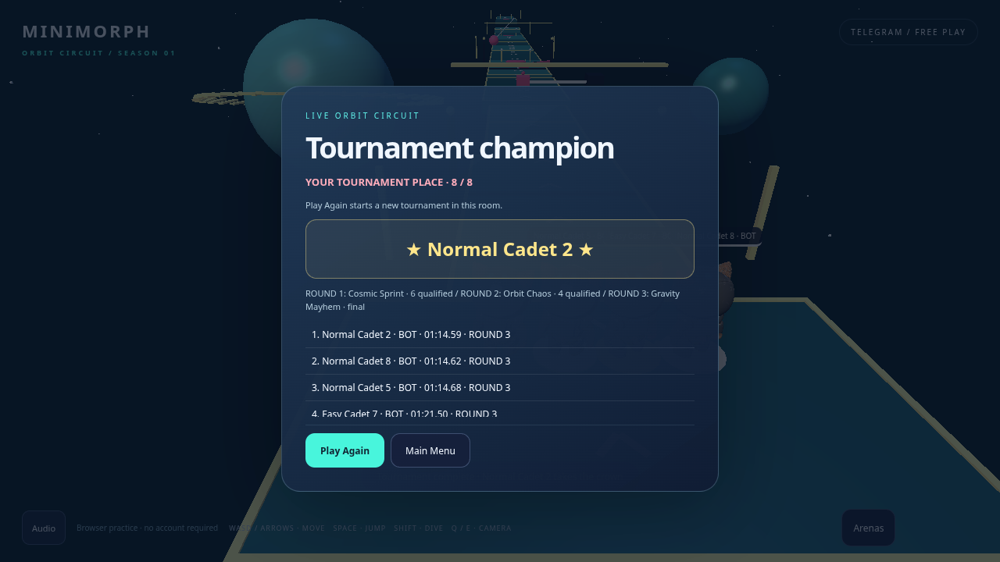

# PR #12 — actual tournament implementation

These screenshots are actual PlayCanvas/game UI frames from the desktop and mobile browser regression. The browser connects by a real WebSocket to this branch's server. A test-only local controller accelerates authoritative time, while bots traverse the real PR #11 courses with ordinary movement inputs. It does **not** set positions, checkpoints, placements or qualification. The idle human is eliminated in round 1, remains in the same room as a spectator, reconnects during intermission and watches the bot finalists complete their race.

| State | Desktop | Mobile |
| --- | --- | --- |
| Lobby: eight slots, format and human/bot roster | [View](desktop-lobby.png) | [View](mobile-lobby.png) |
| Cosmic Sprint: round 1 race, top six qualify | [View](desktop-round-1.png) | [View](mobile-round-1.png) |
| Frozen qualification/elimination result | [View](desktop-qualification.png) | [View](mobile-qualification.png) |
| Orbit Chaos: round 2 and server standings | [View](desktop-round-2.png) | [View](mobile-round-2.png) |
| Gravity Mayhem: four-player final | [View](desktop-final.png) | [View](mobile-final.png) |
| Spectator: followed racer and switching controls | [View](desktop-spectator.png) | [View](mobile-spectator.png) |
| Champion, final placements, rematch/menu actions | [View](desktop-champion.png) | [View](mobile-champion.png) |

Desktop previews:

The review freezes each server phase for inspection; elapsed race durations shown in result rows are genuine simulated race durations. Accelerated testing is not a physical-device benchmark or a production latency measurement. These are not illustrated mockups, composites or replacement characters. The model, original materials/textures, lighting, geometry and effects are preserved from merged PR #11.

Per-profile JSON records actual viewport, device-pixel ratio, canvas buffer, arena and phase for each capture. `scope-integrity.json` records the base revision and protected asset/source checks. The screenshots were captured from the working implementation before commit; the final source hashes are recorded separately. Reproduce with the command in [the tournament contract](../../tournament.md#validation-evidence-and-limits).

Known limits and approval boundary: the existing procedural Dive/Slide/Recovery art remains provisional. A Netlify preview needs this branch's backend for online tournaments; a previous WORLD_REVISION is intentionally rejected. Full local test setup and matching deployment requirements are documented in [the tournament contract](../../tournament.md). No production merge or visual approval is implied by these captures.
