# PR #10 — visual and listening review

**Owner approval is required before merging these artistic changes. Automated success is not art approval.** The approved production character asset remains unchanged. The action-pose bridge below is provisional; final high-quality Dive/Slide/Get-up clips remain an external asset requirement, not a completed deliverable. [Exact asset specification](../../action-animation-asset-spec.md).

All pictures are actual PlayCanvas/browser renders. The baseline is merged PR #9 (`ae0008d`); the new version uses identical arena geometry, the same approved character, fixed 1280×720 viewport/drawing buffer and DPR 1. Review-harness cameras and arena phase are matched. The main-menu/race UI captures are live browser frames, not pixel-diff gates. No generated illustrations, composited character replacements or lowered resolution are used.

## Arena appearance

| Arena | Before | After |
| --- | --- | --- |
| Cosmic Sprint | <a href="before-cosmic-sprint-arena.png">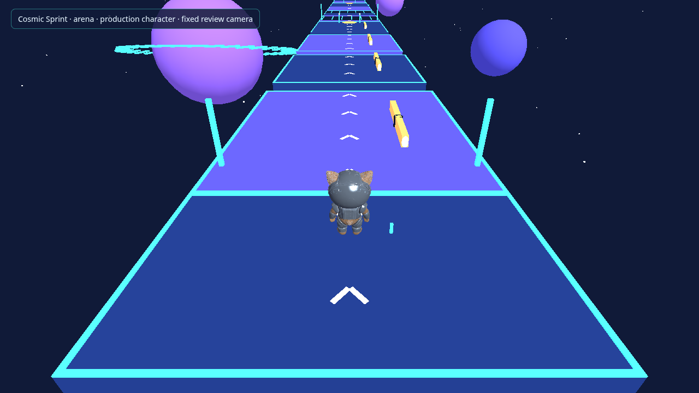</a> | <a href="after-cosmic-sprint-arena.png">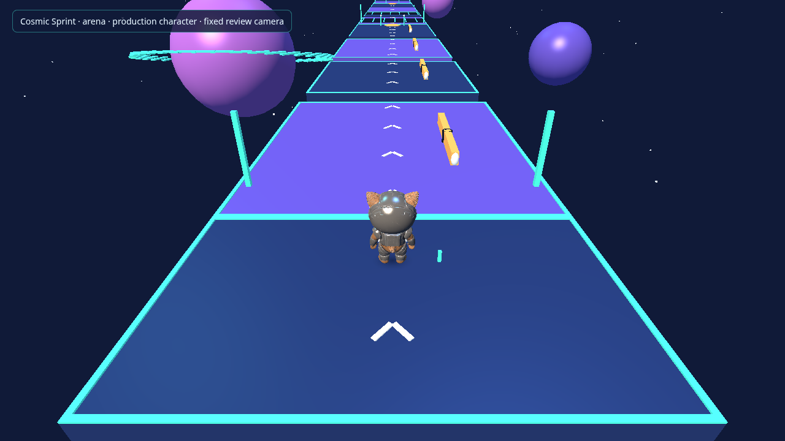</a> |
| Orbit Chaos | <a href="before-orbit-chaos-arena.png">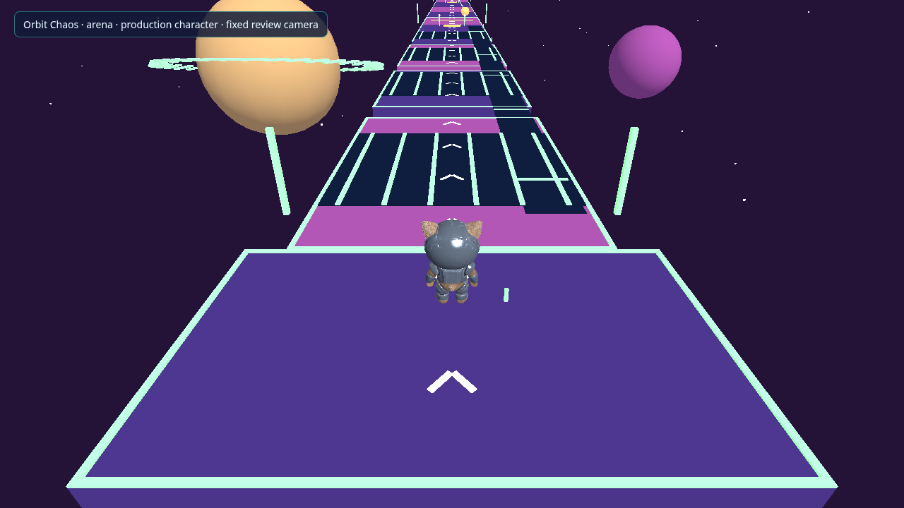</a> | <a href="after-orbit-chaos-arena.png">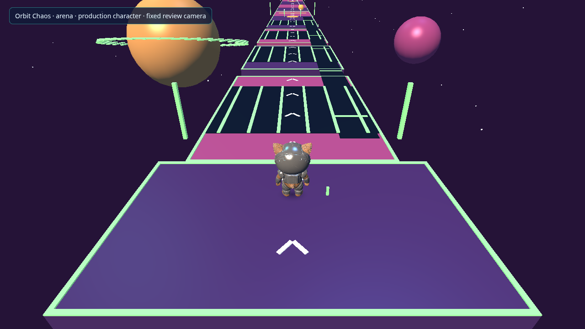</a> |
| Gravity Mayhem | <a href="before-gravity-mayhem-arena.png">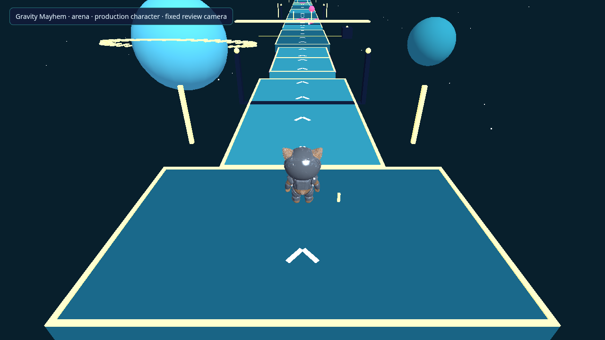</a> | <a href="after-gravity-mayhem-arena.png">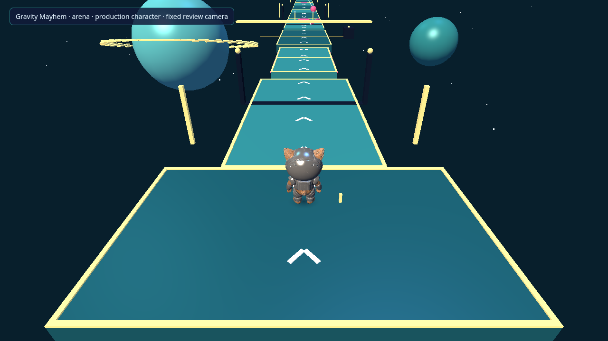</a> |

The warm key/cool fill/cyan rim rig adds depth and character separation. Arena materials use restrained glow and consistent specular response. Geometry, palette identities and route layouts are retained. Soft contact shadows are new; directional world-cast shadow maps are not claimed.

## Provisional action presentation

| Action | PR #9 whole-entity tilt | Multi-bone procedural bridge |
| --- | --- | --- |
| Dive | <a href="before-cosmic-sprint-dive.png">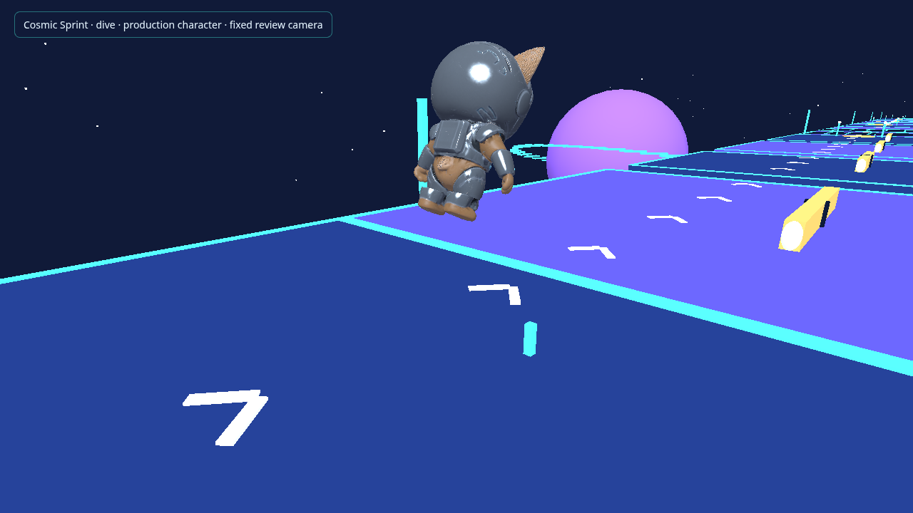</a> | <a href="after-cosmic-sprint-dive.png">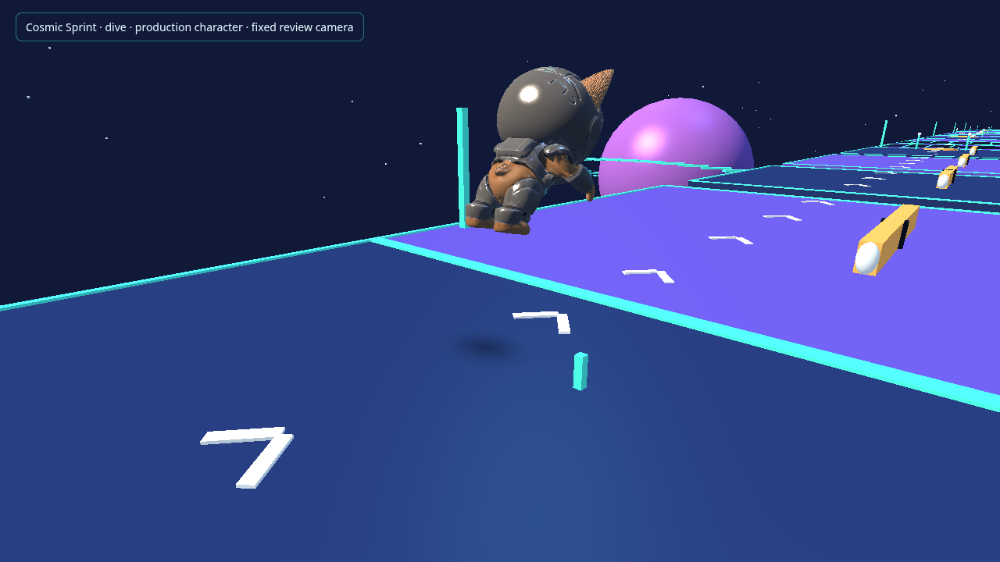</a> |
| Belly Slide | <a href="before-cosmic-sprint-slide.png">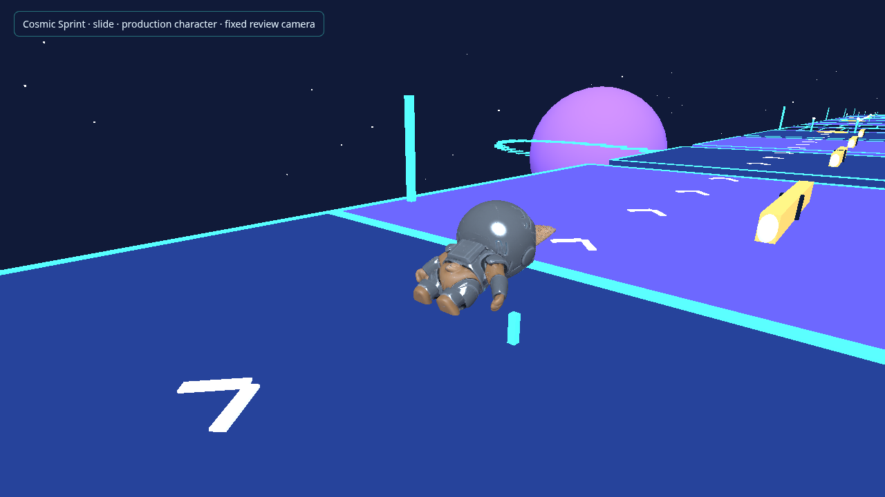</a> | <a href="after-cosmic-sprint-slide.png">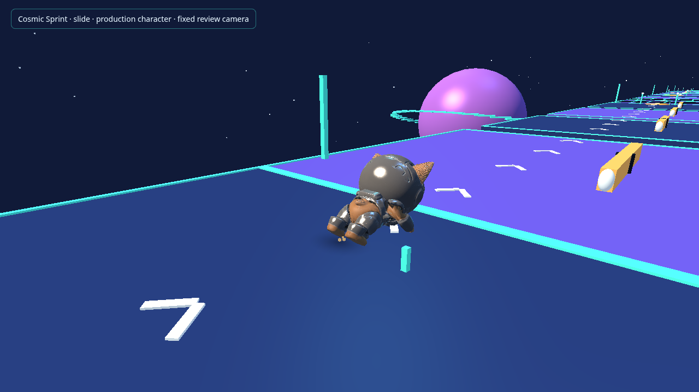</a> |
| Recovery midpoint | <a href="before-cosmic-sprint-recover.png">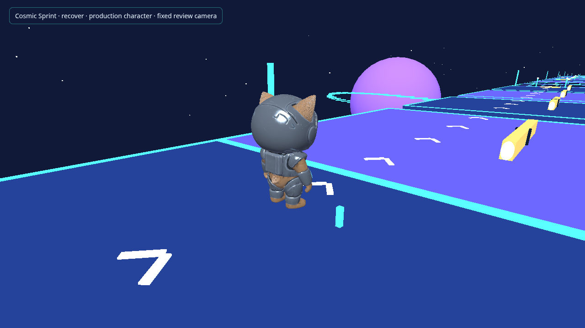</a> | <a href="after-cosmic-sprint-recover.png">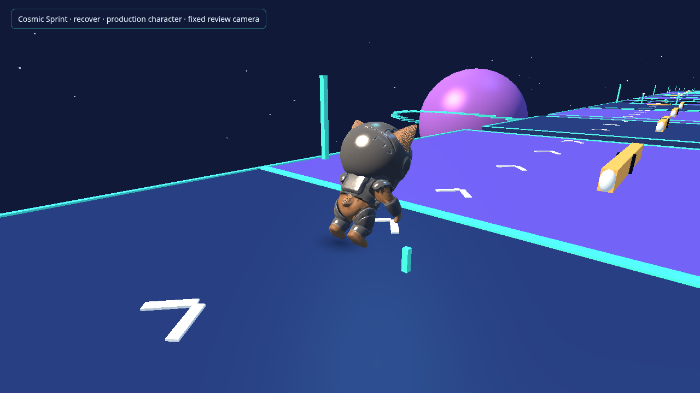</a> |

The character presentation entity stays upright; the existing skeleton now supplies reach, brace, leg fold and timed recovery with smoothing. The GLB, bind data, skin weights, proportions, textures, materials and six supplied clips are byte-identical. **No planted-contact IK or final authored action clips are present.** Hand/foot contact, inherited joint strain and the very short get-up remain limitations. These captures do not imply high-quality action animation is complete or owner-approved.

## Feedback and interface

| View | Before | After |
| --- | --- | --- |
| Landing VFX | <a href="before-cosmic-sprint-vfx.png">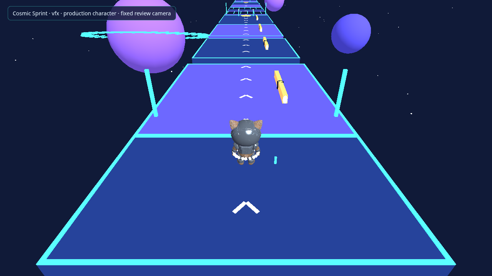</a> |  |
| Menu | <a href="before-menu.png">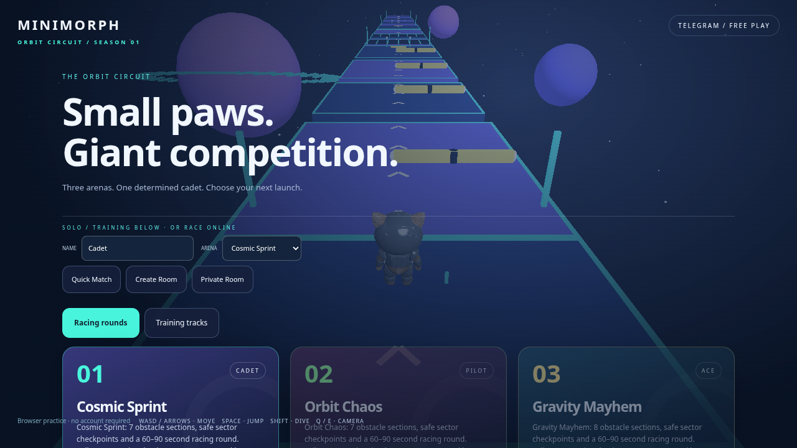</a> | <a href="after-menu.png">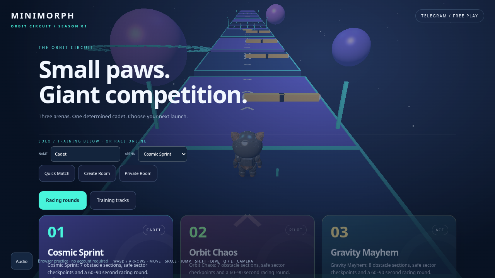</a> |
| Race | <a href="before-race.png">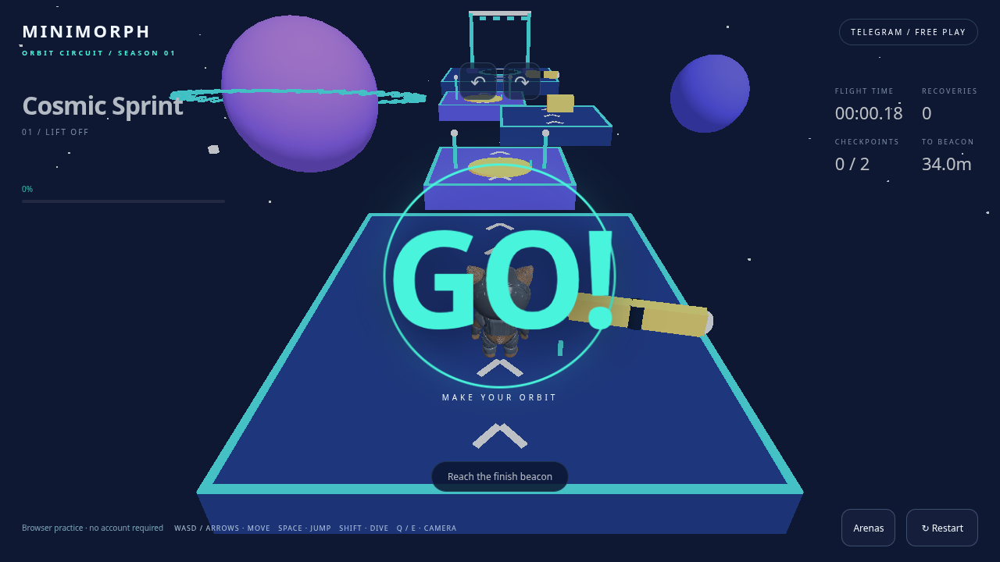</a> | <a href="after-race.png">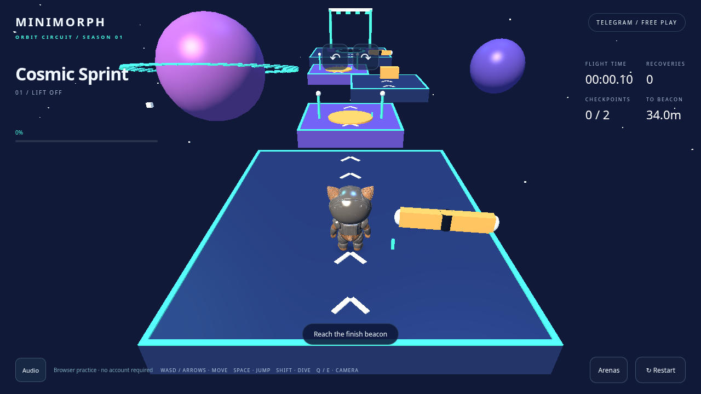</a> |

Additional new feedback: [checkpoint pulse](after-cosmic-sprint-vfx-checkpoint.png), [finish/victory burst](after-cosmic-sprint-vfx-victory.png), and [audio settings panel](after-audio-settings.png). Effects are staged near the launch area in the isolated harness for inspection; these pictures do not claim a race was completed there. Slide trails are visible in the action review. The shared pools serve local and remote participants and stay bounded at 48 sparks/eight impact pulses/nine contact-shadow slots.

Actual keyboard-driven Jump → Dive → Slide captures (same protected movement system):

| Gameplay action | PR #9 | PR #10 |
| --- | --- | --- |
| Dive | [Before](before-gameplay-dive.png) | [After](after-gameplay-dive.png) |
| Slide / landing trail | [Before](before-gameplay-slide.png) | [After](after-gameplay-slide.png) |

The isolated VFX harness keeps the character stationary, so small world-space particles can be partly occluded by it; the gameplay captures also show the character moving away from the impact/trail. The matched landing-effect pair samples 220 ms after emission. Other static scene/action captures settle for 1.8 s; checkpoint/victory examples are after-only staged cues.

## Listening review

Run `npm run preview:character` and open **http://127.0.0.1:5175/audio-review.html** to audition all original assets without autoplay. The game provides the final volume mix and fades through its Audio panel.

| Music | Asset |
| --- | --- |
| Menu | [menu.wav](../../../assets/audio/menu.wav) |
| Race | [race.wav](../../../assets/audio/race.wav) |
| Results | [results.wav](../../../assets/audio/results.wav) |

[Jump](../../../assets/audio/jump.wav) · [Land](../../../assets/audio/land.wav) · [Dive](../../../assets/audio/dive.wav) · [Slide](../../../assets/audio/slide.wav) · [Collision](../../../assets/audio/collision.wav) · [Checkpoint](../../../assets/audio/checkpoint.wav) · [Countdown](../../../assets/audio/countdown.wav) · [Start](../../../assets/audio/start.wav) · [Finish](../../../assets/audio/finish.wav) · [Victory](../../../assets/audio/victory.wav).

All are original synthetic arcade audio with [CC0 provenance](../../../assets/audio/LICENSE.md) and a [reproducible manifest](../../../assets/audio/manifest.json). No audio asset is missing; owner listening/mix approval remains required. The compositions are short looping motifs, not a claim of studio production quality.

## Mechanical validation and protected scope

Local `npm run check` passed 117 unit/integration/server tests, 22 existing Python checks, candidate integrity across 30 sampled poses, thirteen audio hash/format/peak/fade checks, types/lint, both frontend builds, server build, exact approved character/audio packaging and MDS ZIP validation. New focused browser checks passed on desktop/mobile, including actual autoplay/setting persistence, unchanged DPR, skeletal pose activation, remote effects and expiration. Full existing browser/multiplayer CI is recorded in PR #10. Existing strict original-rig deformation diagnostics remain unchanged and nonblocking under the accepted exception.

No shared simulation, movement constants, protocol v2, server, prediction/reconciliation, bots, level geometry, camera controls, rendering resolution/DPR or approved character binaries were changed. No new physical-device benchmark was required or run. [Full implementation/limitations and reproduction](../../visual-audio-polish.md).
