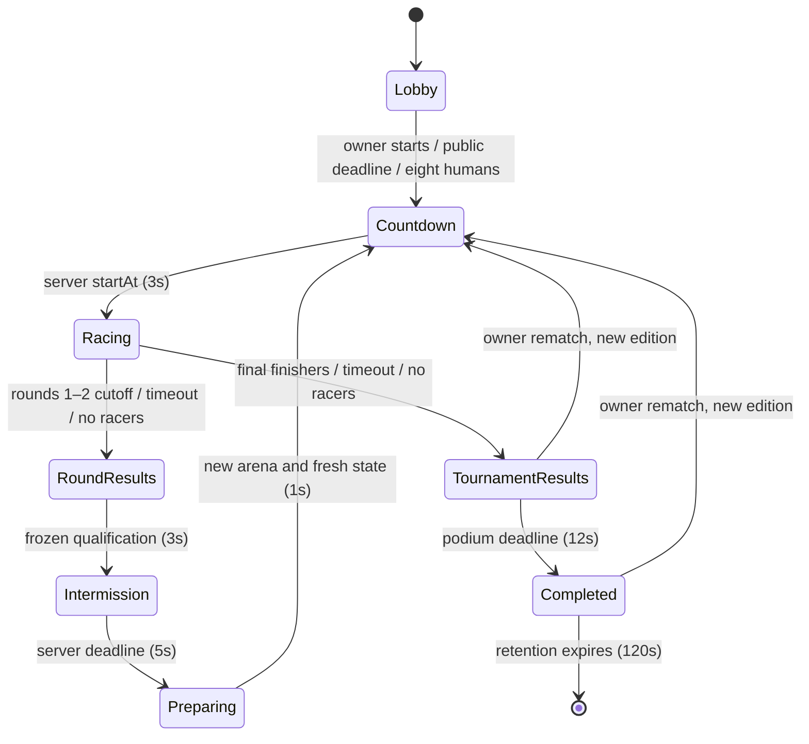

# PR #12 — tournament and qualification contract

The default Quick Match and private-room experience is a three-round tournament: **Cosmic Sprint 8 → 6, Orbit Chaos 6 → 4, Gravity Mayhem 4 → champion**. A single room, roster identity, invitation code and reconnect session span all rounds. Solo/training and their saved progression remain separate. Choose **Single race** to use the retained standalone multiplayer race and arena selector.

## Server state machine



Wire phase names are `waiting` (lobby), `countdown`, `racing`, `round-results`, `intermission`, `preparing`, `tournament-results` and `completed`. The standalone race retains `finished`. Qualification/elimination are authoritative decisions frozen on entry to `round-results`, not an extra client-controlled phase. Every transition has a phase guard. Already-consumed owner start/rematch requests are harmless no-ops; non-owner or future-edition requests are rejected. Duplicate control packets cannot start a second round or edition.

The race deadline is server controlled, **240 seconds per round by default**. Rounds 1/2 close early when six/four eligible players finish. The final names its champion from the earliest authoritative simulation finish, resolving equal times by participant ID even if the tied finish is observed in a later tick. Remaining finalists may finish until all are done or the deadline expires. Holding phases use synchronized server deadlines. Clients display those deadlines and never advance the room themselves.

## Qualification, ties and timeouts

- Physics remains the shared 120 Hz simulation, four substeps per 30 Hz room tick. Finish times come from server simulation time, never client clocks. The cutoff is checked after processing the whole tick, so participant iteration order cannot steal an equal-time qualification.
- Finishers rank by finish time, then stable participant ID for exact ties. Nonfinishers rank below finishers by checkpoints reached, forward course position (`z`), then ID. The server publishes the live `orderIds`; the tournament HUD does not calculate standings or qualification locally.
- At timeout, the highest-ranked **eligible** participants fill the six/four qualifying places, including DNFs if necessary. This keeps an otherwise stalled bracket playable. A timeout-qualified player's own result explicitly says progress ranking. Bots receive no special priority or automatic qualification; bot finishers still traverse actual geometry using ordinary movement inputs.
- Permanent leavers and participants whose reconnect grace expired are withdrawn and cannot qualify. A disconnected participant inside the grace period is still eligible; disconnect does not pause their clock or create a replacement bot.
- Frozen qualification is immutable. If a qualifier withdraws during intermission, they are omitted from the next active roster; nobody is promoted from an already frozen result, and no eliminated slot is refilled. Consequently rounds can have fewer than six/four entrants after withdrawals. The normal populated bracket remains exactly 8 → 6 → 4.
- If no finalist finishes, the best finalist by the same progress/ID ordering becomes champion. If nobody can enter the final because all qualifiers withdrew, the highest-ranked participant from the furthest completed round is the deterministic fallback. DNF times remain `null`; the server does not fabricate a finish or change checkpoint/physics state to award the fallback.
- Final placements are unique and stable: finalists first, then players eliminated in round 2, then round 1, using their frozen round order. Normally these are places 1–4, 5–6 and 7–8. The table labels the round to which each time belongs.

Championship ordering uses one policy everywhere: higher round reached first, then the frozen place in that round. Each round ranks actual finishers by simulation time then lexical participant ID; DNFs follow by checkpoints, forward progress and ID. A withdrawal before preparation excludes that entrant from the next round; withdrawal during a round retains their entry and last progress. An already recorded finish survives withdrawal. There are no replacement finalists. The champion ID, first overall placement and first stored final-result row always name the first participant in this order. When final entries exist, their frozen order is the prefix of overall placements. Live championship leadership is derived from that same finish ordering rather than latched separately.

An empty final keeps `activeIds`, `orderIds` and final-history rows empty: it never fabricates a finalist or a final finish. Countdown closes that empty race immediately into tournament results, then the normal podium deadline reaches completed. The fallback champion comes from the furthest actually played round. Placement status/time refer to the labelled last round reached; any DNF time stays `null`. The client contract checks all championship representations against the same frozen records, including this empty-final case. Reconnect and owner-controlled rematch use the ordinary lifecycle.

Each round is persisted once through the existing result store. Current-edition history contains three frozen round records (at most eighteen rows); the final stored result also contains all eight placements and the champion ID. The existing memory store retains at most 100 records, and the optional append-only file store remains available.

## Roster and reconnect lifecycle

Tournament lobbies materialize eight slots immediately. Joining humans replace provisional bots until the roster locks. Quick Match starts after the existing fifteen-second deadline or eight humans; the private owner can start immediately. Bots keep their existing easy/normal/hard navigation variation. No new entrant can join after countdown begins. Empty waiting lobbies are reclaimed; after start, a room continues through completion even if all humans leave.

Participant IDs, colors, human/bot roles, room ID and invitation code survive each round. Reconnect tokens are retained across rounds and rotate only on resume, as before. The **20-second reconnect grace** applies during races, results, intermission, preparation and the podium. Resume returns the complete current snapshot, including history, bracket membership, current arena and spectator role. A player eliminated while disconnected resumes as an eliminated observer, never as a restored racer. Expired/permanently revoked tokens cannot resurrect an entrant.

For tournaments, a disconnected owner transfers control to the first connected human when one exists. With no connected replacement, a returning human can claim the otherwise unreachable ownership. Round advancement never depends on the owner. Owner-only private start and rematch checks remain server enforced.

Preparation creates fresh `PlayerState` and `ArenaRuntime` instances for qualifiers and a new shared collapse-trigger map. Velocity, knockback, support attachment, checkpoints/splits, Dive/Slide/Recovery timers, held-input latches, jump buffers and cooldowns do not carry over. Old command queues are discarded and acknowledgements advanced to the server's last accepted sequence. Identity and reconnect tokens remain intact.

## Protocol v2 and deployment

`PROTOCOL_VERSION` stays **2**. `WORLD_REVISION` is now **`tournament-v1-galactic-park-v2`** for editor v0.3, covering the shared optional-checkpoint finish rules as well as the redesigned collision world. PR #13 used `tournament-v1-galactic-park-v1`. PR #12 used `tournament-v1-advanced-races-v1`. Orbit Chaos and Gravity Mayhem retain their PR #11 content. The guard is not relaxed: old/new server and frontend builds must not be mixed. Join/resume reject a revision mismatch before allocating a room or rotating a token. Clients also validate snapshot shape, arena/round coherence, unique bounded participant lists, history and placements before rendering, and discard regressive edition/round/tick/phase snapshots.

New bounded v2 fields:

| Field | Contract |
| --- | --- |
| Join `experience` | Optional `tournament` or `race`; omitted defaults to tournament. A private invitation joins the room's actual mode. |
| Input `round`, `tournament` | Round 1–3 and edition 1–1,000,000. Required for tournament movement; optional for a standalone race. Wrong/stale context is rejected before queueing or changing acknowledgements. |
| Replay | `{v:2,type:'replay',tournament:edition}`; only the current owner, current edition and podium/completed phase can rematch. |
| Snapshot `tournament` | Edition, round, active/order/qualified/eliminated IDs, three frozen round records, champion, placements and server transition/race deadlines. |

Strict input parsing still rejects position, checkpoint, qualification and finish authority claims. Clients clear prediction and interpolation history at a new room/edition/round; same-round reconnect keeps the visual event ledger. The game resets presentation on an epoch change even when a rematch returns to Cosmic Sprint. Shared movement constants and prediction substeps are unchanged.

Snapshot arrays are bounded to eight IDs/participants, three history records and eight placements. History contains results, not copies of player physics states. The full real-bot lifecycle regression checks encoded snapshots stay below 32 KiB; the client's existing 128 KiB receive limit remains in place. No unbounded per-round log is broadcast.

Deploy matching backend, Telegram frontend and optional Minima package after owner approval. A PR preview still pointing at the older production backend intentionally refuses online play. Solo/training remain usable; for online review run this branch's backend and build with the matching `VITE_MULTIPLAYER_WS_URL`. No production backend is changed by this PR, and no new paid infrastructure is introduced.

## Spectating, presentation and replay

Eliminated and already-finished humans may follow remaining active racers. The client stops producing movement packets; the server rejects eliminated spectator commands independently. Previous/next controls choose only active participants, and the HUD names the followed racer and exposes server standings. Camera switches reframe immediately. Rendering uses one main followed avatar plus the other active avatars, so rounds show at most 8/6/4 characters; eliminated participants are not rendered as extra ghosts.

Lobby, round HUD, qualification/intermission, spectator and champion panels reuse the existing visual language. Original sounds cover race start, individual finish, qualification, elimination, final-round entry and champion reveal. Individual finishes have a once-only ledger event even when finishing immediately switches the camera to another racer. A bounded decision ledger seeds historical events silently on reconnect and suppresses repeats. Tournament finish/victory audio is coordinated with that ledger to avoid playing a second winner cue from repeated movement snapshots; existing gameplay VFX and licensed audio assets remain intact.

**Play Again** by the owner starts a new edition in the same room with connected roster identities retained; withdrawn slots may receive new bots for this new tournament. No refills happen between its rounds. A non-owner's Play Again finds a new Quick Match, as explained in the panel. Main Menu/leave returns to the existing Solo/training selection.

## Validation, evidence and limits

[Actual desktop/mobile in-engine evidence](evidence/tournament/README.md). Server tests cover real full-course bot tournaments, eight human-role entrants driven only by legal round-bound test inputs (without state writes), one-human-plus-bots, all-human departure, ties, timeouts/no finishers, role/epoch rejection, state reset, result persistence, reconnect in every phase, eliminated/disconnected entrants, ownership, private/quick rooms and replay. Client/protocol tests cover snapshot coherence, stale snapshots, prediction epochs, no spectator movement and deduplicated feedback. Browser tests exercise the real lobby → qualification → next arenas → spectator/reconnect → champion → rematch path and standalone race selection/results.

Run `npm run check` and `npm run test:browser`. To capture the tournament review again:

```sh
TOURNAMENT_EVIDENCE=1 PLAYWRIGHT_CHROMIUM_EXECUTABLE_PATH=/path/to/chromium npm run test:browser -- tests/browser/tournament.spec.ts
```

The Playwright setup starts a **test-only loopback server** on WS 3012 and a bounded clock controller on 3013. It accelerates `MatchService.tick` with ordinary bot inputs and coalesces review snapshots; it never injects player positions, checkpoints, qualification or results. Between review commands physics stays frozen, while network time continues so the unchanged server rate limiters and heartbeats operate normally. Production build entry points do not import this controller. Browser tests redirect their real WebSocket transport to that matching server. Screenshots therefore show actual implementation states, not mockups or synthetic UI.

Known limits: rooms and tokens remain in-process and do not survive a backend restart. Resume tokens are held by the live client instance; a page reload/new tab starts a new join rather than recovering a stored token; reconnect is the existing twenty-second grace, not durable cross-restart recovery. Withdrawals can shrink a later bracket without replacement. The PR #10 procedural action-animation bridge and its existing art limitations are preserved. No new physical-device benchmark or 30 FPS claim is made. Approved character/rig/textures, PR #11 geometry, movement constants, lighting, effects, audio assets and rendering resolution/DPR remain unchanged.

Do not merge automatically. Owner approval is required before activating the tournament in production.
